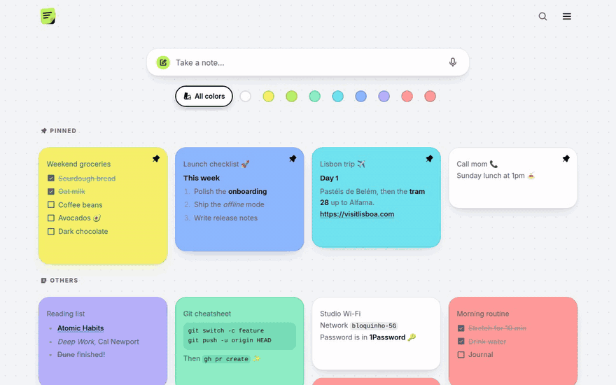
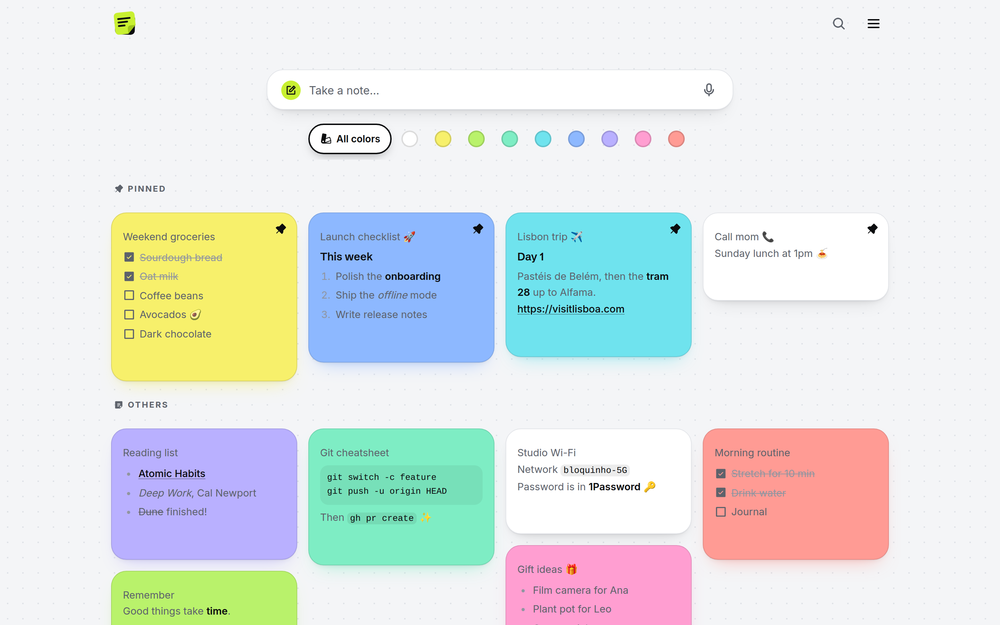
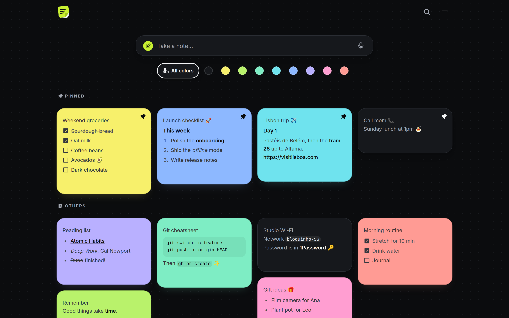

# Bloquinho

An installable, offline-first PWA for quick notes. Works in the browser, on desktop and on mobile, with optional sync across devices.

**Live demo:** [bloquinho](https://bloquinho.pages.dev)



## Features

- **Offline first**: notes are saved on the device (IndexedDB) and work without internet
- **Optional sync**: sign in to sync notes across devices through Supabase
- **Markdown**: formatting, checklists and links
- **Organize**: color labels, pinning, search and drag-and-drop reordering
- **Voice dictation**: Web Speech API with a local Whisper fallback
- **Installable**: add to the home screen or install from Chrome or Edge
- **Themes**: light, dark and system
- **Bilingual**: English and Portuguese

| Light | Dark |
| --- | --- |
|  |  |

## Tech stack

- [React 19](https://react.dev), TypeScript and [Tailwind CSS 4](https://tailwindcss.com)
- [Vite](https://vite.dev) with vite-plugin-pwa
- [Dexie](https://dexie.org) (IndexedDB)
- [Supabase](https://supabase.com) for auth and sync
- Whisper via transformers.js in a Web Worker
- Vitest and Testing Library

## Getting started

```bash
npm install
cp .env.example .env.local
npm run dev
```

Without `.env.local`, the app runs in local-only mode. To enable sync, add your Supabase URL and anon key and run the files in `supabase/migrations/` in order.

| Command             | Description                                 |
| ------------------- | ------------------------------------------- |
| `npm run dev`       | Start the dev server                        |
| `npm test`          | Run the tests                               |
| `npm run lint`      | Lint with oxlint                            |
| `npm run typecheck` | Run type checking                           |
| `npm run build`     | Build for production into `dist/`           |
| `npm run preview`   | Serve the build locally with service worker |

## Project structure

```
src/
├── auth/         Session and sync context
├── components/   UI components and hooks
├── db/           Dexie schema
├── i18n/         Setup and translations
├── notes/        Note types, repository, Markdown and filters
├── sync/         Sync engine and Supabase adapter
├── voice/        Voice dictation
└── ...           Supabase client, theme
supabase/
└── migrations/   Database schema, RLS and RPCs
```

## License

[MIT](LICENSE). Developed by [icka.dev](https://icka.dev).
